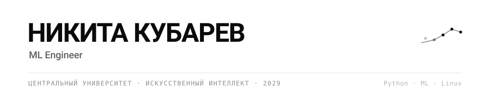

<picture>
  <source media="(prefers-color-scheme: dark)" srcset="banner-dark.svg">
  
</picture>

Второй курс, направление «Искусственный интеллект», Центральный университет.

Занимаюсь прикладным ML: веду полный пайплайн, объясняю результаты.

Москва · [t.me/mrknef](https://t.me/mrknef) · [резюме](nikitos.site/ml-resume)

---

## Проекты

### Прогнозирование отказов серверов

Предупреждение об отказе веб-сервиса примерно за 100 секунд до него. Не детекция и уведомление после случившегося, а прогноз - обычный мониторинг сообщает когда сервис уже упал.

Данные не синтетические. Пять машин, три часа, контролируемые аварии пяти типов, разметка отказов по внешней пробе с гистерезисом. Признаки из скользящих окон, валидация по времени и отдельно на машине, которую модель не видела.

Главный результат не в метрике модели, а в сравнении. Оба метода в одинаковом режиме Alertmanager, с подтверждением в три интервала и дедупликацией:

|                    | Модель | Порог по одной метрике |
|--------------------|--------|------------------------|
| Тревог поднято     | 5      | 12                     |
| Из них по делу     | 4      | 0                      |
| Точность           | 80 %   | 0 %                    |
| Упреждение         | ~100 с | нет                    |

Ограничения названы в README проекта: 31 авария в тестовом окне, recall 13 процентов, доверительные интервалы широкие.

`Prometheus` `CatBoost` `SHAP` `aiogram` `systemd`

### Прогрессия после гамма-ножа

Модель оценивает риск повторного роста метастазов в мозге после радиохирургии. Реальные клинические данные НМИЦ им. Бурденко, 583 пациента, 18 признаков, работа в команде научной студии.

**PR-AUC 0.899** при базовом уровне 0.657, ROC-AUC 0.795, balanced accuracy 0.723.

Отдельная часть работы: во второй версии найдена и измерена утечка. Порог подбирался на тех же предсказаниях, по которым шел отчет. После выноса подбора во вложенные фолды balanced accuracy честно упала с 0.742 до 0.723, и эти 1.9 пункта первая версия получала даром. Отрицательный результат по ансамблю тоже оставлен: смесь трех моделей проиграла одиночному CatBoost.

`CatBoost` `LightGBM` `XGBoost` `Optuna` `SHAP` `вложенная кросс-валидация`

### PRIME

Telegram мини-приложение и бот для клуба мероприятий: регистрация, профили, механики для участников, административная панель.

`FastAPI` `aiogram 3` `SQLAlchemy async` `PostgreSQL`

### Своя сетевая инфраструктура

Множество VPS под полным управлением: ноды, бот, веб-панель, мониторинг на Prometheus. Администрирование, домены, поддержка пользователей.

`Linux` `systemd` `Docker` `Nginx` `Prometheus`

---

## Навыки

| Область | Инструменты |
|---|---|
| **Машинное обучение** | CatBoost, LightGBM, XGBoost, scikit-learn, Optuna, SHAP |
| **Методы** | feature engineering, k-fold и вложенная кросс-валидация, out-of-fold предсказания, подбор порога, работа с дисбалансом классов, ROC-AUC и PR-AUC, интерпретация моделей |
| **Данные** | pandas, NumPy, Matplotlib, предобработка, работа с пропусками и выбросами |
| **Backend** | Python, FastAPI, aiogram 3, SQLAlchemy async, REST, асинхронность, фоновые задачи |
| **Базы данных** | PostgreSQL, MongoDB, Redis |
| **Инфраструктура** | Linux (Arch как основная система), Bash, Docker, Git, systemd, SSH, Prometheus, администрирование VPS |
| **Языки** | Python, SQL, Bash · English B1 |

**Чему учусь сейчас:** алгоритмы и структуры данных, математическая статистика за пределами курса, калибровка вероятностей.

---

## Еще

Двукратный чемпион России в соревнованиях «Профессионалы» по БПЛА
Играю в большой теннис 13 лет
Arch Linux как вторая система, сторонник Open Source.

---

Telegram [@mrknef](https://t.me/mrknef) · Москва и удаленно · открыт к предложениям
